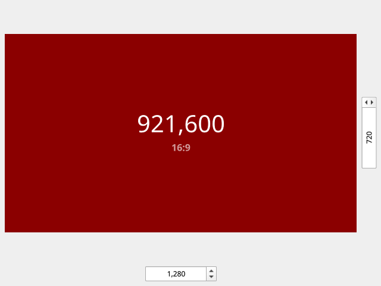

# Rectio

A minimalist and elegant utility for calculating rectangle area and aspect ratios.



## ✨ Features
* Calculate area and simplify aspect ratios (e.g., 1920x1080 becomes 16:9).
* Smart responsive layout: text remains readable even with extreme aspect ratios.
* Smooth animations and hover effects.
* Clean and modern UI using Qt Quick Controls 2.

## 🛠 Tech Stack
* **Language:** C++
* **UI Framework:** Qt 6 / QML
* **Build System:** CMake

## 🚀 Building from Source
1. Install [Qt 6](https://www.qt.io/download) (requires Qt Quick and Qt Quick Controls 2 components).
2. Clone the repository:
   ```bash
   git clone https://github.com/Derrfil/Rectio.git
   cd Rectio
   ```
3. Open CMakeLists.txt in Qt Creator, configure the project, and build.

## 📄 License
This project is licensed under the GNU GPLv3. See the LICENSE file for details.